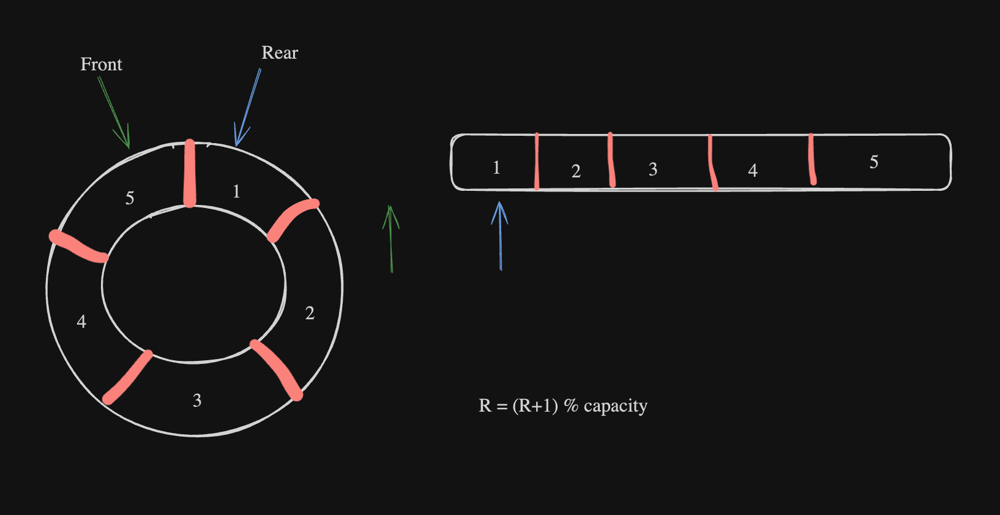

[← Back to main README](../README.md)

# Circular Queue

A fixed capacity FIFO built on an array. When the rear index reaches the end, it wraps back to the start, so freed slots are reused without shifting any data.

| File | What it contains |
|---|---|
| [`Circular_Queue.c`](Circular_Queue.c) | First implementation with `push`, `pop`, `front`, `empty` and a print helper |
| [`Circular_Queue_Practice.c`](Circular_Queue_Practice.c) | From scratch rewrite that resets `front` and `rear` when empty and tests wraparound |
| [`Circular_Queue_Image.png`](Circular_Queue_Image.png) | Hand drawn diagram of the ring and its array view |

## How it works

<p align="center">
  
</p>

| Operation | Index update | Guard |
|---|---|---|
| `push(x)` | `rear = (rear + 1) % capacity` | Reject if `size == capacity` |
| `pop()` | `front = (front + 1) % capacity` | Reject if `size == 0` |
| `front()` | read `arr[front]` | Queue must not be empty |

## Build and Run

```bash
cd Queue

gcc -std=c11 -Wall Circular_Queue.c -o circular_queue && ./circular_queue
gcc -std=c11 -Wall Circular_Queue_Practice.c -o circular_queue_practice && ./circular_queue_practice
```

<details>
<summary><b>Show sample output (<code>Circular_Queue.c</code>)</b></summary>

<br/>

Pushes 1, 2, 3, 4 then pops once:

```text
2 3 4
```

</details>

<details>
<summary><b>Show sample output (<code>Circular_Queue_Practice.c</code>)</b></summary>

<br/>

Fills the queue, overflows it, empties it, then refills it so the rear index wraps around:

```text
Welcome to Online IDE!! Happy Coding :)
1 2 3 4 5 
Queue is FULL!
Front of the queue = 1
1 2 3 4 5 
Front of the queue = 2
Queue is EMPTY!

30 40 50 60 70 
```

</details>
