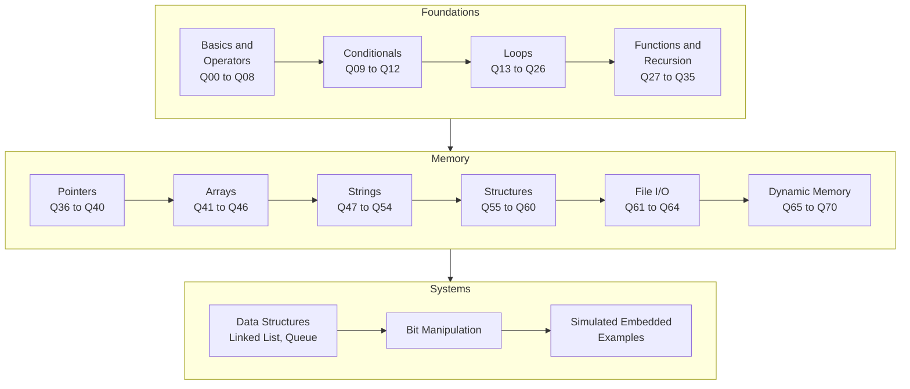
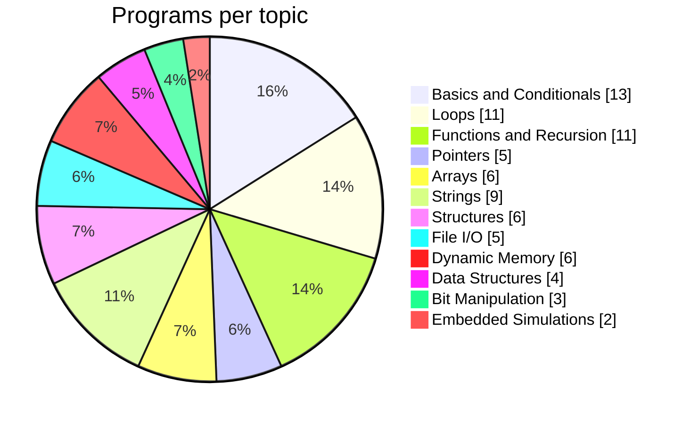

<div align="center">

# C Experiments

**A hands on journal of learning C, from `printf("Hello World")` all the way to bit level packet parsing and memory mapped registers for embedded systems.**


[](https://codespaces.new/pushkaraj-s/C-experiments)

</div>

---

## Table of Contents

* [About](#about)
* [Learning Roadmap](#learning-roadmap)
* [Quick Start](#quick-start)
* [Topic Explorer](#topic-explorer)
* [Cheat Sheets](#cheat-sheets)
* [Progress Tracker](#progress-tracker)
* [Repository Structure](#repository-structure)

---

## About

This repository is my personal lab notebook for C. Every file is a small, self contained program that answers one question or explores one concept. Most files open with a comment describing the problem, followed by the solution and, where useful, the expected output.

The early files (`Q00` to `Q70`) follow a classic C curriculum. The folders build on that foundation with data structures, bit manipulation, and simulated embedded firmware scenarios, which is where C really shines.

> [!TIP]
> New to the repo? Start with the [Learning Roadmap](#learning-roadmap) below, then jump into any topic in the [Topic Explorer](#topic-explorer). Every topic is collapsible, so click to expand.

---

## Learning Roadmap



### Programs by topic



---

## Quick Start

### Option 1: Run in the browser (no setup)

Click the **Open in GitHub Codespaces** badge at the top. The default Codespaces image already includes `gcc`, so you can compile and run any file straight from the terminal.

### Option 2: Run locally

```bash
git clone https://github.com/pushkaraj-s/C-experiments.git
cd C-experiments

# Compile and run a single program
gcc -x c -std=c11 -Wall Q21_Factorial_of_Number.C -o factorial
./factorial
```

> [!WARNING]
> Most files in this repo use an uppercase **`.C`** extension. GCC and Clang treat `.C` as **C++** by default, so always pass **`-x c`** to compile them as C. Programs that use `math.h` (for example `Q29`) also need **`-lm`** at the end.

<details>
<summary><b>Build every program at once</b> (click to expand)</summary>

<br/>

```bash
mkdir -p build
for f in $(git ls-files '*.C' '*.c'); do
  out="build/$(basename "${f%.*}")"
  if gcc -x c -std=c11 "$f" -o "$out" -lm 2>/dev/null; then
    echo "built    $f"
  else
    echo "skipped  $f  (notes file or placeholder)"
  fi
done

# The C++ linked list
g++ -std=c++17 Linked_List/Linked_List.cpp -o build/Linked_List_cpp
```

A handful of files are intentionally **notes only** and are skipped by this script: `Q07`, `Q11`, `Q43`, `Q50.1` and `Q61.0` contain explanations written inside the source, and `Q24` to `Q26` are empty homework placeholders.

</details>

<details>
<summary><b>Files that read or write data files</b></summary>

<br/>

| Program | File used | Mode |
|---|---|---|
| [`Q61.1`](Q61.1_FileIO_read_int_from_file.C) | `test.txt` | reads 5 integers |
| [`Q62`](Q62_FileIO_input_student_info.C) | `student.txt` | writes |
| [`Q63`](Q63_FileIO_store_odd_numbers.C) | `text.txt` | writes |
| [`Q64`](Q64_FileIO_sum_of_numbers_in_file.C) | `test.txt` | reads two numbers, then overwrites with their sum |

Create `test.txt` in the folder you run the program from before trying `Q61.1` or `Q64`:

```bash
echo "4 8 15 16 23" > test.txt
```

</details>

---

## Topic Explorer

Click any topic to expand it. Every program name links straight to its source.

<details>
<summary><b>1. Basics, Operators and Conditionals</b> &nbsp;(Q00 to Q12, 13 programs)</summary>

<br/>

| # | Program | Concept |
|---|---|---|
| Q00 | [Hello World](Q00_Hello_World.C) | First program, `printf` |
| Q01 | [Area of Square](Q01_Area_of_Square.C) | Reading `float` input with `scanf` |
| Q02 | [Area of Circle](Q02_Area_of_Circle.C) | Arithmetic with floating point |
| Q03 | [Type Conversion](Q03_Type_Conversion.C) | Implicit float to int truncation |
| Q04 | [Operator Precedence](Q04_Operator_Precedence.C) | Precedence and associativity rules |
| Q05 | [Divisible by 2](Q05_Divsible_by_2.C) | Modulo operator with `if / else` |
| Q06 | [Even or Odd](Q06_Even_or_Odd.C) | Converting input before using `%` |
| Q07 | [Valid or Invalid Syntax](Q07_Valid_invalid_Syntax.C) | Spotting syntax errors *(notes)* |
| Q08 | [Print True or False](Q08_Print_True_or_False.C) | Logical `&&` and `\|\|` |
| Q09 | [Pass or Fail](Q09_Pass_Or_Fail.C) | `if / else if` ranges |
| Q10 | [Pass or Fail with Grades](Q10_Pass_Fail_With_Grades.C) | Multi branch grading |
| Q11 | [Will this Code...?](Q11_Will_this_Code.C) | The `=` vs `==` pitfall *(notes)* |
| Q12 | [Upper or Lower Case](Q12_Upper_case_or_Lower_case.C) | ASCII ranges for characters |

</details>

<details>
<summary><b>2. Loops</b> &nbsp;(Q13 to Q26, 11 programs + 3 homework slots)</summary>

<br/>

| # | Program | Concept |
|---|---|---|
| Q13 | [Print 0 to 10](Q13_For_Loop_Print_0to10.C) | Basic `for` loop |
| Q14 | [Print 0 to N](Q14_For_Loop_Print_0toN.C) | Loop bound from user input |
| Q15 | [Sum of First n Natural Numbers](Q15_Sum_of_First_n_Natural_Numbers.C) | Accumulator pattern |
| Q16 | [Table of n](Q16_Table_of_number_n.C) | Multiplication table |
| Q17 | [Stop When Odd is Entered](Q17_Stop_when_odd_number_is_input.C) | `while` loop with a sentinel |
| Q18 | [Stop at a Multiple of 7](Q18_Stop_when_number_is_multiple_of_7.C) | Loop exit condition |
| Q19 | [Print 1 to 10 Except 6](Q19_Print_1to10_except_6.C) | `continue` keyword |
| Q20 | [Odd Numbers from 5 to 50](Q20_Print_odd_numbers_from_5to50.C) | Filtering with modulo |
| Q21 | [Factorial](Q21_Factorial_of_Number.C) | Using `double` for large results |
| Q22 | [Reverse Table](Q22_Print_reverse_of_a_table.C) | Decrementing loop |
| Q23 | [Sum from 5 to 50](Q23_Sum_of_numbers_from5to50.C) | Inclusive range sum |
| Q24 to Q26 | [HW1](Q24_HWQ1_Unsloved.C), [HW2](Q25_HWQ2_Unsloved.C), [HW3](Q26_HWQ3_Unsloved.C) | Homework placeholders, not solved yet |

</details>

<details>
<summary><b>3. Functions and Recursion</b> &nbsp;(Q27 to Q35, 11 programs)</summary>

<br/>

| # | Program | Concept |
|---|---|---|
| Q27 | [Print Hello and Goodbye](Q27_Functions_Print_Hello.C) | Declaration, definition and call |
| Q28 | [Namaste and Bonjour](Q28_Namaste_and_Bonjour.C) | Picking a function from user input |
| Q29 | [Library Function for Square](Q29_Use_library_funtion_for_square.C) | `pow()` from `math.h` |
| Q30 | [Sum of n using Recursion](Q30_sum_of_n_numbers_using_recursion.C) | Base case and recursive case |
| Q31.0 | [Area using Functions](Q31.0_Functions_Calculate_area_using_functions.C) | Multiple functions with parameters |
| Q31.1 | [Factorial using Recursion](Q31.1_Recursion_Factorial_of_n.C) | Classic recursion |
| Q32.0 | [Hello World via Recursion](Q32.0_Recusrion_example_Hello_world.C) | Recursion in place of a loop |
| Q32.1 | [Celsius to Fahrenheit](Q32.1_Functions_celsius_to_farenheit.C) | Returning `float` values |
| Q33 | [Calculate Percentage](Q33_Functions_calculate_percentage.C) | Passing multiple arguments |
| Q34 | [Fibonacci Sequence](Q34_Recursion_fibonachi_sequence.C) | Printing n terms recursively |
| Q35 | [Fibonacci Nth Term](Q35_Recursion_fibonachi_Nth_term.C) | Returning a single term |

</details>

<details>
<summary><b>4. Pointers</b> &nbsp;(Q36 to Q40, 5 programs)</summary>

<br/>

| # | Program | Concept |
|---|---|---|
| Q36 | [Pointer Basics](Q36_Pointer_Basics.C) | `&`, `*` and printing with `%p` |
| Q37 | [Double Pointer](Q37_Pointers_double_pointer.C) | Pointer to a pointer |
| Q38 | [Swap Numbers](Q38_Pointers_swap_numbers.C) | Pass by value vs pass by reference |
| Q39 | [Address of a Variable](Q39_Poniters_address_of_pointer.C) | Addresses across function scopes |
| Q40 | [Sum, Product, Average](Q40_Pointers_sum_prod_avg.C) | Returning multiple values via pointers |

</details>

<details>
<summary><b>5. Arrays</b> &nbsp;(Q41 to Q46, 6 programs)</summary>

<br/>

| # | Program | Concept |
|---|---|---|
| Q41 | [Price of Items with GST](Q41_Arrays_price_of_items.C) | `float` arrays, 18% GST |
| Q42 | [Count Odd Numbers](Q42_Arrays_count_odd_numbers.c) | Passing arrays to functions |
| Q43 | [Find the Output](Q43_Arrays_find_output.C) | Pointer arithmetic and out of bounds access *(notes)* |
| Q44 | [Reverse an Array](Q44_Arrays_reverse_an_array.C) | Temporary array approach |
| Q45 | [Fibonacci in an Array](Q45_Arrays_fibonachi_numbers.C) | Variable length arrays |
| Q46 | [Tables of 2 and 3](Q46_Arrays_table_of_2_and_3.C) | 2D arrays |

</details>

<details>
<summary><b>6. Strings</b> &nbsp;(Q47 to Q54, 9 programs)</summary>

<br/>

| # | Program | Concept |
|---|---|---|
| Q47 | [First and Last Name](Q47_Strings_first_lastname.C) | Looping until the `'\0'` terminator |
| Q48 | [gets and puts](Q48_Strings_gets_puts.C) | Reading strings, `scanf("%s")` |
| Q49 | [Print Length](Q49_Strings_print_length.C) | `fgets` and manual length count |
| Q50.0 | [Input using %c](Q50.0_Strings_input_using_%25c.C) | Character by character input |
| Q50.1 | [String Library Functions](Q50.1_Strings_library_functions.C) | `strlen`, `strcpy`, `strcat`, `strcmp` *(notes)* |
| Q51 | [Salting](Q51_Strings_salting.C) | Appending a salt to a password |
| Q52 | [Custom Slicing](Q52_Strings_custom_slicing.C) | Substring between two indices |
| Q53 | [Count Vowels](Q53_Strings_no_of_vowels.C) | Character matching |
| Q54 | [Character Present or Not](Q54_Strings_char_present_or_not.C) | Linear search in a string |

</details>

<details>
<summary><b>7. Structures</b> &nbsp;(Q55 to Q60, 6 programs)</summary>

<br/>

| # | Program | Concept |
|---|---|---|
| Q55 | [Student Data](Q55_Structures_student_data.C) | Defining and using a `struct` |
| Q56 | [Print Address](Q56_Structures_print_address.C) | `typedef` and passing structs to functions |
| Q57 | [Sum of Vectors](Q57_Structures_sum_of_vectors.C) | Returning a struct through a pointer |
| Q58 | [Complex Numbers](Q58_Structures_complex_numbers.C) | The arrow operator `->` |
| Q59 | [Marks of Students](Q59_Structures_marks_of_students.C) | Array vs struct tradeoffs |
| Q60 | [Use of Alias](Q60_Structures_use_of_alias.C) | `typedef` aliases |

</details>

<details>
<summary><b>8. File I/O</b> &nbsp;(Q61 to Q64, 5 programs)</summary>

<br/>

| # | Program | Concept |
|---|---|---|
| Q61.0 | [File I/O Theory](Q61.0_FileIO_theory.C) | `FILE *`, modes, open and close *(notes)* |
| Q61.1 | [Read Integers from a File](Q61.1_FileIO_read_int_from_file.C) | `fscanf` |
| Q62 | [Store Student Info](Q62_FileIO_input_student_info.C) | `fprintf` |
| Q63 | [Store Odd Numbers](Q63_FileIO_store_odd_numbers.C) | Writing a range to a file |
| Q64 | [Sum of Numbers in a File](Q64_FileIO_sum_of_numbers_in_file.C) | Read, compute, overwrite |

</details>

<details>
<summary><b>9. Dynamic Memory Allocation</b> &nbsp;(Q65 to Q70, 6 programs)</summary>

<br/>

| # | Program | Concept |
|---|---|---|
| Q65 | [5 Float Prices](Q65_DMA_5_float_prices.C) | `malloc` with a `NULL` check |
| Q66 | [malloc](Q66_DMA_malloc.C) | User sized allocation |
| Q67 | [calloc](Q67_DMA_calloc.C) | Zero initialized allocation |
| Q68 | [realloc](Q68_DMA_realloc.C) | Growing a block from 5 to 8 elements |
| Q69 | [calloc with User Input](Q69_DMA_user_input_for_calloc.C) | Filling a heap array |
| Q70 | [Odd then Even](Q70_DMA_odd_malloc_even_realloc.C) | Reusing a block with `realloc` |

</details>

<details>
<summary><b>10. Data Structures</b> &nbsp;(Linked List and Queue)</summary>

<br/>

| File | What it implements |
|---|---|
| [`Linked_List/Linked_List.c`](Linked_List/Linked_List.c) | Singly linked list with `push_front`, `push_back`, `pop_front`, `pop_back`, `count_nodes` |
| [`Linked_List/Linked_List.cpp`](Linked_List/Linked_List.cpp) | Class based list with head and tail pointers, `insert` at position and `search` |
| [`Queue/Circular_Queue.c`](Queue/Circular_Queue.c) | Fixed capacity ring buffer using modulo indexing |
| [`Queue/Circular_Queue_Practice.c`](Queue/Circular_Queue_Practice.c) | From scratch rewrite with a wraparound test |

Walkthroughs with diagrams and sample output: [Linked List README](Linked_List/README.md) and [Queue README](Queue/README.md).

</details>

<details>
<summary><b>11. Bit Manipulation</b></summary>

<br/>

| File | What it covers |
|---|---|
| [`Bit_Manipulation_Basics.C`](Bit_Manipulation/Bit_Manipulation_Basics.C) | Set, clear and check a single bit in an 8 bit register |
| [`Count_No_of_1s.C`](Bit_Manipulation/Count_No_of_1s.C) | Counting set bits (population count) |
| [`Count_No_of_0s.C`](Bit_Manipulation/Count_No_of_0s.C) | Counting cleared bits |

</details>

<details>
<summary><b>12. Simulated Embedded Examples</b></summary>

<br/>

| File | Scenario |
|---|---|
| [`32bit_Packet_tracing.C`](Simulated_Embedded_Examples/32bit_Packet_tracing.C) | Stateful receiver that decodes and reassembles 32 bit packets |
| [`Washing_Machine_Drum_Velocity.C`](Simulated_Embedded_Examples/Washing_Machine_Drum_Velocity.C) | Control loop writing to a memory mapped actuator register |

Diagrams, packet layout and sample output are in the [folder README](Simulated_Embedded_Examples/README.md).

</details>

---

## Cheat Sheets

<details>
<summary><b>Bit manipulation</b></summary>

<br/>

| Goal | Expression |
|---|---|
| Set bit `n` | `reg \|= (1u << n);` |
| Clear bit `n` | `reg &= ~(1u << n);` |
| Toggle bit `n` | `reg ^= (1u << n);` |
| Check bit `n` | `if (reg & (1u << n)) { ... }` |
| Extract a field | `(reg >> shift) & mask` |
| Count set bits | loop `i` over the width: `count += (reg >> i) & 1u;` |

</details>

<details>
<summary><b>malloc vs calloc vs realloc</b></summary>

<br/>

| Function | Signature | Initializes memory? | Typical use |
|---|---|---|---|
| `malloc` | `malloc(n * sizeof(T))` | No, contents are garbage | Fast allocation you fill yourself |
| `calloc` | `calloc(n, sizeof(T))` | Yes, all zeros | Arrays that must start at zero |
| `realloc` | `realloc(ptr, newSize)` | Only the old part is kept | Growing or shrinking a block |
| `free` | `free(ptr)` | | Always release what you allocate |

> **Important:** Always check the returned pointer for `NULL` before using it, and assign the result of `realloc` to a temporary pointer first so the original block is not lost if it fails.

</details>

<details>
<summary><b>Pass by value vs pass by reference</b></summary>

<br/>

```c
void swap(int a, int b)    { int t = a; a = b; b = t; }     // changes only local copies
void _swap(int *a, int *b) { int t = *a; *a = *b; *b = t; } // changes the caller's variables
```

See [`Q38_Pointers_swap_numbers.C`](Q38_Pointers_swap_numbers.C) and [`Q39_Poniters_address_of_pointer.C`](Q39_Poniters_address_of_pointer.C).

</details>

---

## Progress Tracker

* [x] Basics, operators and conditionals
* [x] Loops
* [x] Functions and recursion
* [x] Pointers
* [x] Arrays
* [x] Strings
* [x] Structures
* [x] File I/O
* [x] Dynamic memory allocation
* [x] Linked list (C and C++)
* [x] Circular queue
* [x] Bit manipulation basics
* [x] Simulated embedded examples
* [ ] Homework questions Q24 to Q26

---

## Repository Structure

<details>
<summary><b>Show full tree</b></summary>

<br/>

```text
C-experiments/
├── Q00_Hello_World.C ... Q70_DMA_odd_malloc_even_realloc.C   # 70+ curriculum programs
├── Bit_Manipulation/
│   ├── Bit_Manipulation_Basics.C
│   ├── Count_No_of_0s.C
│   └── Count_No_of_1s.C
├── Linked_List/
│   ├── README.md
│   ├── Linked_List.c
│   └── Linked_List.cpp
├── Queue/
│   ├── README.md
│   ├── Circular_Queue.c
│   ├── Circular_Queue_Practice.c
│   └── Circular_Queue_Image.png
├── Simulated_Embedded_Examples/
│   ├── README.md
│   ├── 32bit_Packet_tracing.C
│   └── Washing_Machine_Drum_Velocity.C
├── .gitignore
└── README.md
```

</details>

---

<div align="center">

Built by [Pushkaraj Said](https://github.com/pushkaraj-s) while learning C for embedded and systems software.

If something here helped you, consider giving the repo a star.

</div>
