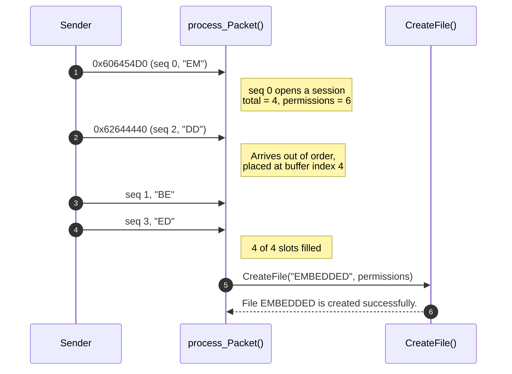
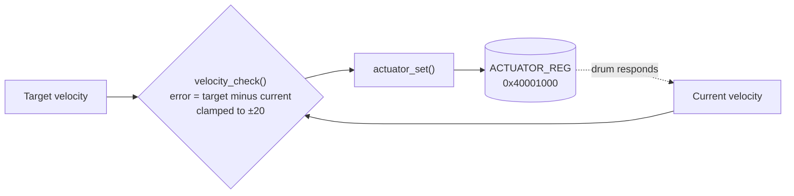

[← Back to main README](../README.md)

# Simulated Embedded Examples

Small programs that mimic real firmware tasks: decoding bit packed protocol frames and driving hardware through memory mapped registers. Everything runs on a regular PC, so no microcontroller is needed.

| Example | Source | Key ideas |
|---|---|---|
| [32 bit Packet Tracer](#32-bit-packet-tracer) | [`32bit_Packet_tracing.C`](32bit_Packet_tracing.C) | Shift and mask decoding, stateful reassembly, out of order packets |
| [Washing Machine Drum Velocity Control](#washing-machine-drum-velocity-control) | [`Washing_Machine_Drum_Velocity.C`](Washing_Machine_Drum_Velocity.C) | `volatile` register access, signed math, saturation limits |

## Build and Run

```bash
cd Simulated_Embedded_Examples

gcc -x c -std=c11 -Wall 32bit_Packet_tracing.C -o packet_tracer && ./packet_tracer
gcc -x c -std=c11 -Wall Washing_Machine_Drum_Velocity.C -o drum_velocity && ./drum_velocity
```

> [!NOTE]
> These files use an uppercase `.C` extension, which GCC and Clang treat as C++ by default. The `-x c` flag makes them compile as C.

---

## 32 bit Packet Tracer

**Source:** [`32bit_Packet_tracing.C`](32bit_Packet_tracing.C)

A receiver that accepts a stream of 32 bit packets one at a time, decodes each field with shifts and masks, reassembles a filename from 2 character fragments (even when they arrive **out of order** or **duplicated**), and finally calls `CreateFile()` with the decoded permissions.

### Packet layout

| Bits | Field | Mask | Description |
|:---:|---|:---:|---|
| 31 : 30 | Message ID | `0xC0000000` | Identifies the message stream |
| 29 : 27 | Number of packets | `0x38000000` | Total packets expected in the stream |
| 26 : 24 | Sequence number | `0x07000000` | Position of this packet in the stream |
| 23 : 20 | Permissions | `0x00F00000` | File access permission bits |
| 19 : 4 | Filename segment | `0x000FFFF0` | Two ASCII characters |
| 3 : 0 | Error code | `0x0000000F` | `0` means success, anything else is dropped |

### How the filename `EMBEDDED` is rebuilt



<details>
<summary><b>Show the decoding logic</b></summary>

<br/>

```c
uint8_t  msg_id       = (packet >> 30) & 0x3u;
uint8_t  num_packets  = (packet >> 27) & 0x7u;
uint8_t  seq_num      = (packet >> 24) & 0x7u;
uint8_t  permissions  = (packet >> 20) & 0xFu;
uint16_t filename_seg = (packet >> 4)  & 0xFFFFu;
uint8_t  error_code   =  packet        & 0xFu;

/* Each packet carries two characters */
char c1 = (filename_seg >> 8) & 0xFF;
char c2 =  filename_seg       & 0xFF;
state.filename_buffer[seq_num * 2]     = c1;
state.filename_buffer[seq_num * 2 + 1] = c2;
```

</details>

<details>
<summary><b>Show sample output</b></summary>

<br/>

```text
================================
Receiving packet 1 of 4
Packet accepted: YES

================================
Receiving packet 2 of 4
Packet accepted: YES

================================
Receiving packet 3 of 4
Packet accepted: YES

================================
Receiving packet 4 of 4
File EMBEDDED is created successfully.
```

</details>

**Concepts used:** fixed width types from `stdint.h`, bit fields via shift and mask, a stateful receiver held in a `static` struct, duplicate detection with a `slot_filled[]` table, and safe string termination.

---

## Washing Machine Drum Velocity Control

**Source:** [`Washing_Machine_Drum_Velocity.C`](Washing_Machine_Drum_Velocity.C)

Simulates a firmware control loop that compares the drum's current speed to a target, clamps the correction to a safe range, and writes it to a **memory mapped actuator register** at `0x40001000`. On a PC the register pointer is redirected to a regular variable so the program can run anywhere.



<details>
<summary><b>Show sample output</b></summary>

<br/>

```text
Starting Drum Velocity Control Loop...
Current: 0 rpm | Target: 10 rpm | Actuator Set To: 10
Current: 3 rpm | Target: 10 rpm | Actuator Set To: 7
Current: 6 rpm | Target: 10 rpm | Actuator Set To: 4
Current: 9 rpm | Target: 10 rpm | Actuator Set To: 1
Current: 12 rpm | Target: 10 rpm | Actuator Set To: -2
```

</details>

**Concepts used:** `volatile` pointers to hardware registers, signed vs unsigned arithmetic (casting to `int16_t` before subtracting to avoid underflow), and saturation limits for actuator safety.
